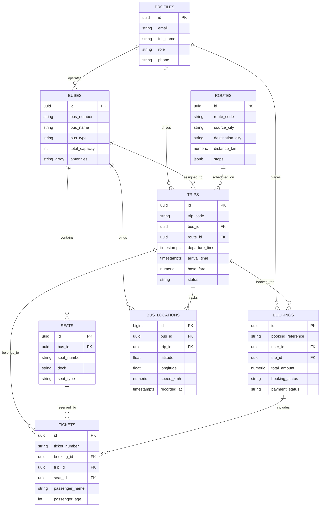

# SafarSaathi (सफर साथी) 🚍

> A modern Bus Management, Reservation & Real-time Transit Tracking System powered by **Supabase** and **PostgreSQL**.

---

## 📖 Overview

**SafarSaathi** provides a complete backend and data repository layer for intercity and local bus transit operations. Built on Supabase, it includes ready-to-deploy database schemas, migrations, seed data, Row-Level Security (RLS) policies, Realtime GPS tracking, and a strongly-typed TypeScript repository pattern.

### Key Features

- 🚌 **Fleet Management**: Track buses, seat layouts (multi-deck, sleeper, seater, Volvo, electric), amenities, and operators.
- 🗺️ **Routes & Stops**: Comprehensive route definitions with waypoint stops, distances, and offset durations.
- 🕒 **Trips & Scheduling**: Dynamic departure/arrival timetables, live trip statuses, and dynamic pricing.
- 🎟️ **Reservations & Ticketing**: Atomic seat reservations, preventing double-bookings with database constraints.
- 🛰️ **Real-Time Bus Tracking**: High-frequency GPS tracking breadcrumbs streamed instantly using Supabase Realtime.
- 🔐 **Security & Access Control**: Full Row-Level Security (RLS) policies for passengers, drivers, operators, and admins.
- 📦 **TypeScript Repository Layer**: Clean repository pattern client (`BusRepository`, `RouteRepository`, `TripRepository`, `BookingRepository`, `LocationRepository`).

---

## 🏗️ Architecture & Database Model



---

## 📁 Project Structure

```text
safarsaathi/
├── supabase/
│   ├── config.toml              # Supabase CLI configuration (project: safarsaathi)
│   ├── migrations/
│   │   └── 20261031000001_safarsaathi_schema.sql  # Core DDL, triggers, RLS, functions
│   └── seed.sql                 # Sample buses, routes, seats, trips, and GPS traces
├── src/
│   ├── client.ts                # Typed Supabase client factory
│   ├── index.ts                 # Main module entry point
│   ├── types/
│   │   └── database.types.ts    # Generated PostgreSQL types
│   ├── repositories/
│   │   ├── base.repository.ts
│   │   ├── bus.repository.ts    # Bus and seat management
│   │   ├── route.repository.ts  # City routes and intermediate stops
│   │   ├── trip.repository.ts   # Trip searches and seat availability
│   │   ├── booking.repository.ts# Atomic ticketing and reservations
│   │   ├── location.repository.ts # Real-time GPS ingest and live streams
│   │   └── index.ts             # Unified repository facade
│   └── examples/
│       └── demo.ts              # Interactive test and demo script
├── .env.example
├── .gitignore
├── package.json
├── tsconfig.json
└── README.md
```

---

## 🚀 Getting Started

### 1. Install Dependencies
```bash
npm install
```

### 2. Local Supabase Development
Ensure Docker Desktop is running, then initialize and start Supabase locally:
```bash
# Start local containers (Postgres, Studio, Auth, Realtime, Storage)
npm run supabase:start

# Check service URLs and keys (API URL: http://127.0.0.1:54321, Studio: http://127.0.0.1:54323)
npm run supabase:status

# Reset and apply migrations + seed data
npm run supabase:reset
```

### 3. Configure Environment Variables
Copy `.env.example` to `.env`:
```bash
cp .env.example .env
```
Fill in the `SUPABASE_URL` and `SUPABASE_ANON_KEY` output from `npm run supabase:status`.

### 4. Run the Demo
```bash
npm run demo
```

---

## 💻 Repository Usage Examples

### Search Available Trips
```typescript
import { safarsaathi } from 'safarsaathi';

// Search trips between Delhi and Jaipur
const trips = await safarsaathi.trips.searchTrips({
  sourceCity: 'Delhi',
  destinationCity: 'Jaipur',
});

console.log(trips);
```

### Check Available Seats
```typescript
const seats = await safarsaathi.trips.getAvailableSeats(tripId);
const availableOnly = seats.filter(seat => seat.is_available);
```

### Reserve Seats & Create Booking
```typescript
const booking = await safarsaathi.bookings.createBooking({
  userId: 'user-uuid',
  tripId: 'trip-uuid',
  passengers: [
    {
      seatId: 'seat-uuid-1',
      passengerName: 'Rahul Sharma',
      passengerAge: 28,
      passengerGender: 'male',
      fare: 850.0,
    },
  ],
});

console.log('Booking confirmed! Reference:', booking.booking_reference);
```

### Stream Live Bus Location in Real-Time
```typescript
const subscription = safarsaathi.locations.subscribeToBusLiveLocation(
  busId,
  (newLocation) => {
    console.log(`Live ping: ${newLocation.latitude}, ${newLocation.longitude}`);
    console.log(`Speed: ${newLocation.speed_kmh} km/h`);
  }
);

// Unsubscribe when done
// subscription.unsubscribe();
```

---

## 🎓 Campus bus GPS tracking (migrations 2–3)

`20261031000002_campus_student_role.sql` and `20261031000003_campus_gps_tracking.sql` add the GEU/GEHU
campus bus model alongside the intercity tables (which are untouched): `campus_buses`, `campus_routes`,
`campus_stops`, schedule imports (verbatim CSV rows), departure slots, driver assignments, student route
choices, trips with frozen route snapshots, latest + historical locations, and a retention function.
Writes come from the tracking server (`Safarsaathi/apps/tracking-server`) with the service role; RLS
gives clients read-only, role-scoped access. See `Safarsaathi/docs/GPS_TRACKING.md`.

Migration 3 also fixes three issues in the initial schema:
- signup no longer trusts `raw_user_meta_data.role` (anyone could self-register as `admin`);
- users can no longer change their own `profiles.role`;
- `bus_locations` is no longer readable by anonymous users or writable by any driver for any bus.

After pulling, regenerate types: `npm run supabase:gen-types`.

---

## ☁️ Deploying to Supabase Cloud

1. **Log in to Supabase CLI**:
   ```bash
   npx supabase login
   ```
2. **Link your Supabase Cloud project**:
   ```bash
   npx supabase link --project-ref <your-project-id>
   ```
3. **Push database migrations & schema**:
   ```bash
   npx supabase db push
   ```

---

## 📄 License
MIT © Vidarbh14
